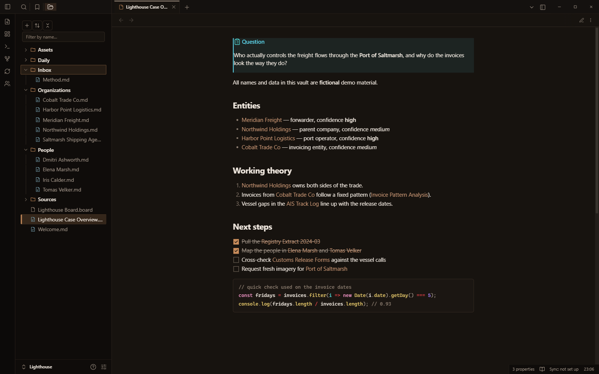
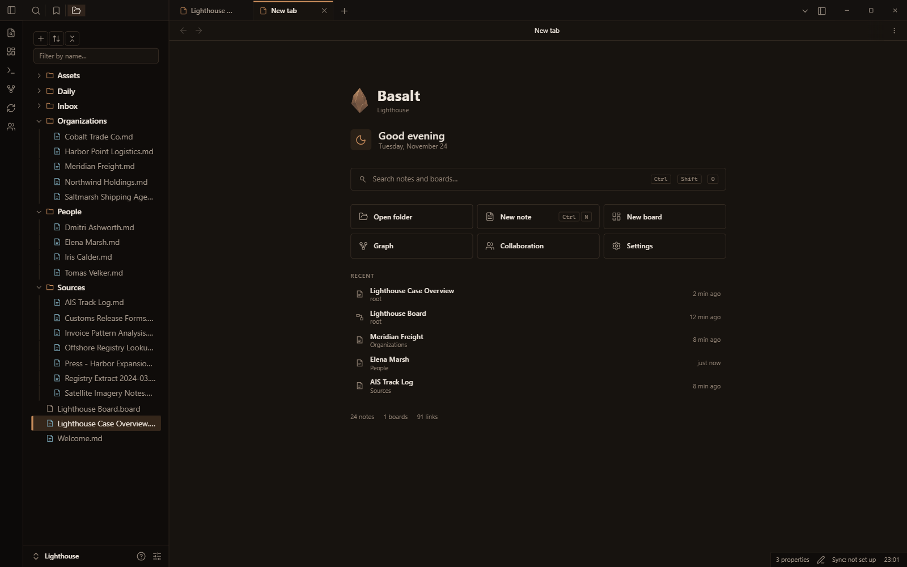
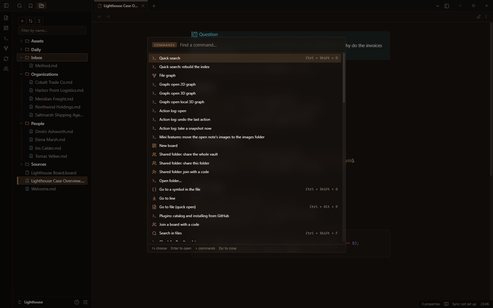
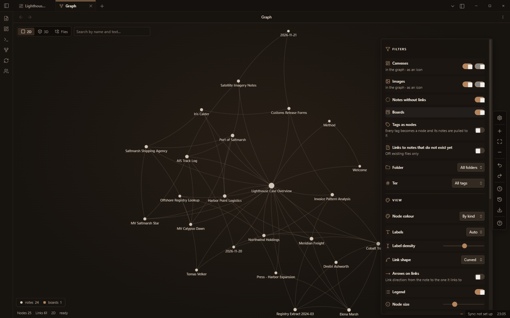
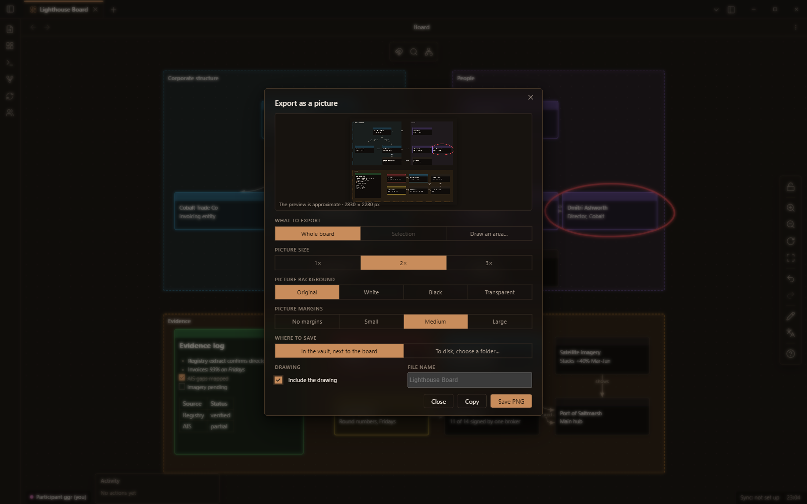
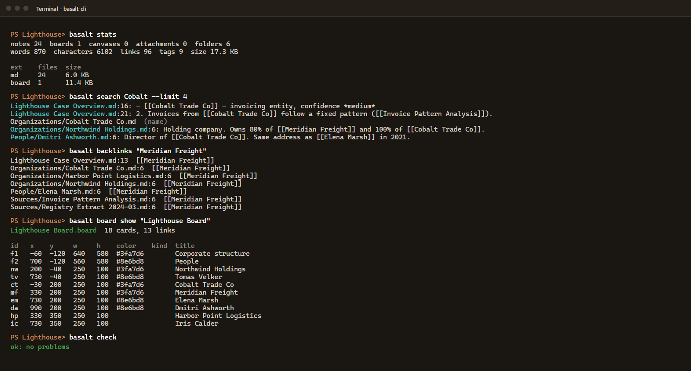

<div align="center">


# Basalt

**Markdown notes, collaborative boards on an infinite canvas, and a link graph. All in plain files on your disk.**

[](https://github.com/FalconTechDev/basalt/releases/latest)


<br>


<sub>An investigation board in Basalt. Every name and fact in the screenshots is fictional demo data.</sub>

</div>

<br>

Basalt is a desktop app for people who think in links. Write notes in Markdown, lay them out on a board next to images, pages and code, and watch the vault grow into a graph. Nothing is locked into a database: your vault is a folder of ordinary files, and everything the app can do is also available from a command line and a local API.

- **Notes** in plain Markdown with `[[wiki links]]`, backlinks, properties, callouts, code blocks and fast full-text search.
- **Boards** that several people can edit at once: cards, links with labels, frames, hand drawing, export to PNG.
- **Graph** of the whole vault in 2D, 3D or by files, with filters and a legend.
- **Action log**: almost every change is recorded and can be undone, and the vault can be rolled back to any moment.
- **CLI and local API** for scripts, hooks and automation, with or without the window open.
- **Plugins** as sandboxed WebAssembly modules, installed from GitHub releases.

## Download and install

1. Open the [**latest release**](https://github.com/FalconTechDev/basalt/releases/latest) and download `Basalt-Setup-<version>.exe` under Assets.
2. Run it and follow the installer.

 Windows 10 or 11, 64-bit. App settings are in `%APPDATA%\Basalt`, per-vault settings in a `.basalt` folder inside the vault.

## Contents

[Install](#download-and-install) · [Notes](#notes) · [Boards](#boards) · [Graph](#graph) · [Export](#export) · [CLI and API](#cli-and-api) · [Plugins](#plugins-webassembly) · [Action log and undo](#action-log-and-undo) · [Terminal](#terminal) · [Quick start](#quick-start) · [Build from source](#build-from-source) · [Project layout](#project-layout) · [Status and provenance](#status-and-provenance) · [Contributing](#contributing) · [License](#license)

---

## Notes



Notes are `.md` files. Link them with `[[double brackets]]`, tag them, give them properties in front matter, and open the file tree, backlinks and outline beside them. Callouts, task lists, tables and highlighted code are built in. The start page shows recent files and a search box.



Everything is reachable from the **command palette** (`Ctrl+P`), which also lists the commands added by Basalt itself.



## Boards

A board is a `.board` file in your vault: an infinite canvas of cards joined by links. A card can hold Markdown, an image, a page, a terminal or code. Links have labels and shapes, cards can be grouped into **frames**, and you can draw on top of everything with a pen, a highlighter, lines and shapes (shapes snap to clean geometry). Large boards stay fast because the canvas runs on a Rust engine compiled to WebAssembly.

Boards are **collaborative**. Peers find each other over WebRTC with a room name and password, every peer keeps a full copy, and edits merge through a CRDT (Yjs), so there is no server to run. An activity feed shows who changed what.

Useful keys on a board: `Space` + drag to pan, `Ctrl` + wheel to zoom, `F` to fit everything, `N` or double-click for a new card, `Z` to fold a card, `Ctrl+D` to duplicate. Press `/` for every board action.

## Graph



The graph shows every note, board and link in the vault. Switch between 2D, 3D and a file-tree layout, search by name and text, hide orphans, show tags as nodes, change node colour, label density and link shape. Boards appear as nodes too.

## Export



Export a whole board, a selection or a drawn area as a PNG at 1x, 2x or 3x, on the original, white, black or a transparent background, with the margins you choose. Save next to the board in the vault or to any folder, or copy straight to the clipboard. From the command line a board also exports to JSON, Markdown, CSV, Mermaid, Graphviz DOT and SVG.

## CLI and API



`cli/basalt.mjs` is a self-contained command line tool (Node.js 20+, no dependencies). **It works on the vault folder directly, with or without the app running**, and it can drive a running app too. The output above is real output on the demo vault.

```bash
node cli/basalt.mjs --vault "D:\Notes" vault info
node cli/basalt.mjs --vault "D:\Notes" search "invoice" -C 2
node cli/basalt.mjs --vault "D:\Notes" backlinks "Meridian Freight"
node cli/basalt.mjs --vault "D:\Notes" check --fail-on broken     # CI-friendly: exit code 4 on problems

node cli/basalt.mjs board new Plans/q1
node cli/basalt.mjs board card add Plans/q1 "Launch" --color green
node cli/basalt.mjs board layout Plans/q1 tree --dir lr           # grid | tree | force
node cli/basalt.mjs board export Plans/q1 --format mermaid --out q1.mmd
```

- Reads and writes notes, moves and renames with link updates, edits properties, handles the daily note, finds broken links and orphans.
- Edits `.board` files directly (cards, links, layouts, import from CSV/JSON/`.canvas`, merge, diff, history).
- Hooks, tasks, a scheduler, webhooks and your own scripts. Nothing runs by itself: automation only works after you enable `basalt trust enable` for that vault.
- Shell completion for PowerShell and bash, `--json` on every command, stable exit codes.

The running app also serves a **local HTTP API** on `127.0.0.1`, protected by a bearer token and closed to browsers. Endpoints are described in [`docs/api/openapi.yaml`](docs/api/openapi.yaml). Full references: [docs/CLI.md](docs/CLI.md) and [docs/API.md](docs/API.md) (these two are written in Russian for now). `node --test cli/test` runs the CLI test suite in temporary vaults.

## Plugins (WebAssembly)

A plugin is a `.wasm` module plus a `manifest.json`. It cannot do anything on its own: it only gets the host functions the app hands it, and sensitive ones only for permissions that are listed in the manifest **and approved by you** when the plugin is enabled.

```json
{ "id": "hello-wasm", "name": "Hello Wasm", "version": "0.1.0", "wasm": "plugin.wasm", "permissions": ["vault.read", "editor"] }
```

Put it in `<vault>/.basalt/wasm-plugins/<id>/`, or install one from the built-in catalog, which reads GitHub releases directly (no store, no account). The SDK and a Rust example are in [plugins-sdk](plugins-sdk/README.md).

## Action log and undo

Basalt keeps a journal of what changed in the vault. From the command palette you can open the **Action log**, undo the last action, or take a snapshot on demand; boards additionally keep their own version history and can be restored or diffed from the CLI (`board history`, `board diff`). The log fills as you work, so a fresh vault starts empty.

## Terminal

There is a terminal inside the app, both under the editor and as a card on a board, so a command, its output and the notes about it can live on the same canvas. The `basalt-cli` shell (`Tab` completes, arrows pick) and `basalt-cli daemon start` (Basalt in the background, no window) cover the headless side.

---

## Quick start

1. Install Basalt (below) and open it. On the start screen choose **Open folder** to use an existing folder of notes, or create a new vault.
2. Press `Ctrl+N` for a note, or **New board** on the start page for a board.
3. Link notes with `[[`, and open the **Graph** from the ribbon to see how they connect.

| Key | Action |
| --- | --- |
| `Ctrl+P` | Command palette |
| `Ctrl+O` | Quick switcher |
| `Ctrl+Alt+P` | Quick open a file (fuzzy) |
| `Ctrl+Shift+F` | Search in files |
| `Ctrl+N` | New note |
| `Alt+D` | Draw in a note |
| `Space` + drag, `Ctrl` + wheel, `F` | Board: pan, zoom, fit |

## Build from source

Requirements: Windows, Node.js 22, PowerShell. For the engines: Rust with the `wasm32-unknown-unknown` target. For the installer: Inno Setup 6 (set `ISCC` if it is not in a standard location).

```powershell
.\run.ps1                          # first run creates .\runtime, then starts Basalt on the checkout
```

`run.ps1` builds the runtime from a **stock Electron 39.8.6** zip (`electron-v39.8.6-win32-x64.zip`, taken from `%LOCALAPPDATA%\electron\Cache` or from `$env:BASALT_ELECTRON_ZIP`): it unpacks it, renames `electron.exe` to `Basalt.exe`, keeps the en-US and ru locales and sets the icon. `runtime\resources\app` and `app-src` are junctions into `stub\` and `src\`, so edits apply on the next launch. Use a separate profile when you test: `runtime\Basalt.exe --user-data-dir=<temp>`.

Generated files in `src/` are rebuilt by small scripts:

```bash
node build-app.mjs [--wasm]        # own modules in src-app/ -> src/app.js (--wasm also builds app-core with cargo)
node build-css.mjs                 # src-css/*.css -> src/app.css
node build-markdown.mjs            # markdown-engine (Rust -> WASM) -> src/worker.js
node build-canvas.mjs              # canvas/graph/search engines (Rust -> WASM) and their hooks; needs cargo
node build-installer.mjs [--version 0.1.0] [--skip-build]
```

`build-installer.mjs` stages `runtime/` and the app into `dist/stage` and runs Inno Setup, producing `dist/Basalt-Setup-<version>.exe`. Without `--skip-build` it first runs `brand.mjs` and `build-canvas.mjs --no-cargo`; with `--skip-build` it packages exactly what is in `src/` and the runtime as they are. For a throw-away test copy on an isolated profile see `tools/test-runtime.ps1` and `tools/smoke-local.sh`.

## Project layout

| Path | What it is |
| --- | --- |
| `src/` | The app as it runs: `basalt-*.js` feature modules, `app.js` and `app.css` (generated), icons |
| `src-app/` | Basalt's own core modules, spliced into `src/app.js` by `build-app.mjs` |
| `src-css/` | Stylesheet sources, built into `src/app.css` |
| `stub/` | Electron main process entry |
| `cli/` | `basalt` command line (Node, no dependencies), Rust `basalt-cli` client and tests |
| `canvas-engine/`, `graph-engine/`, `search-engine/`, `markdown-engine/`, `app-core/` | Rust crates compiled to WebAssembly |
| `pty-helper/` | Rust helper behind the terminal |
| `plugins-sdk/` | WebAssembly plugin SDK and the `hello-wasm` example |
| `installer/` | Inno Setup script |
| `branding/` | Logo and icons |
| `docs/` | CLI, API (`api/openapi.yaml`), UI style, roadmap and provenance notes |
| `tools/` | Test, audit and measurement scripts (smoke tests, board stress tests, inherited-code stats) |
| `vendor/` | Third-party libraries with their licences and a manifest |

## Status and provenance

Basalt is a young project and is under active development. It began as a modified copy of a proprietary application and is being replaced piece by piece: the shell, search, graph, action log, boards, terminal, CLI, API and main process are Basalt's own code today, while a small part of the original code is still inside the generated `src/app.js`. It also bundles third-party open source libraries.

Basalt is not affiliated with, endorsed by or sponsored by Obsidian / Dynalist Inc. The exact picture, with what still derives from the original and what that means for redistribution, is in [THIRD_PARTY.md](THIRD_PARTY.md) and [docs/REPLACING_INHERITED_CODE.md](docs/REPLACING_INHERITED_CODE.md).

## License

Basalt's own files are licensed under the [GNU Affero General Public License v3.0](LICENSE). The AGPL covers what Basalt's authors wrote; it does not relicense third-party libraries (see [vendor/](vendor/README.md) and [THIRD_PARTY.md](THIRD_PARTY.md)) or any code that still derives from the original application.
