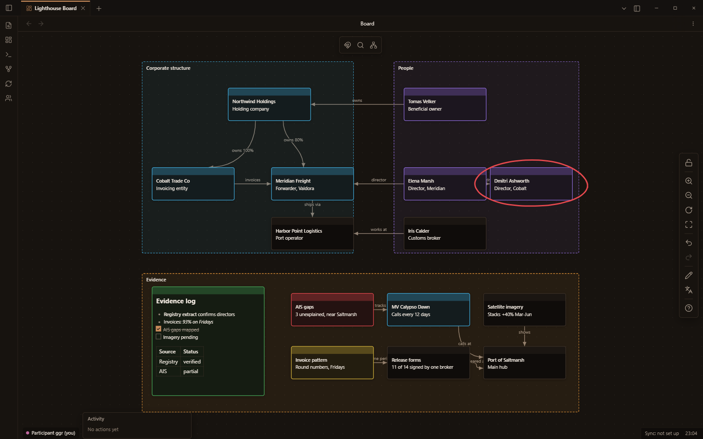

<div align="center">


# Basalt

Markdown notes, boards on an infinite canvas, and a graph of how it all links. Your vault is a normal folder of files.

[Download for Windows](https://github.com/FalconTechDev/basalt/releases/latest)

<br>



</div>

<br>

I wanted one place to write, to lay out evidence or ideas as cards, and to script all of it. Basalt does that without a database or an account: notes are `.md` files, boards are `.board` files, and everything the app does is also available from a command line.

## What it does

- **Notes** in Markdown with `[[links]]`, backlinks, properties and full-text search.
- **Boards**: cards, labelled links, frames, hand drawing, export to PNG. Several people can edit one board at once over WebRTC, no server involved.
- **Graph** of the whole vault, 2D or 3D, with filters.
- **Action log**: changes are recorded and can be undone or rolled back.
- **CLI and local API** that work on the vault with or without the window open.
- **Plugins** as sandboxed WebAssembly modules.


## Command line

```bash
node cli/basalt.mjs --vault "D:\Notes" search "invoice" -C 2
node cli/basalt.mjs --vault "D:\Notes" backlinks "Meridian Freight"
node cli/basalt.mjs board card add Plans/q1 "Launch" --color green
node cli/basalt.mjs board export Plans/q1 --format mermaid --out q1.mmd
```

Node.js 20+, no dependencies. The running app also serves an HTTP API on `127.0.0.1` behind a token: [openapi.yaml](docs/api/openapi.yaml). References: [CLI](docs/CLI.md), [API](docs/API.md) (both in Russian for now).

## Build

Windows, Node.js 22, PowerShell. Rust and Inno Setup only if you rebuild the engines or the installer.

```powershell
.\run.ps1                                              # builds .\runtime from stock Electron, starts Basalt on the checkout
node build-app.mjs --no-cargo                          # src-app/ -> src/app.js
node build-css.mjs                                     # src-css/ -> src/app.css
node build-installer.mjs --version 0.3.8 --skip-build  # dist/Basalt-Setup-0.3.8.exe
```

More in [CONTRIBUTING.md](CONTRIBUTING.md). Tests: `node --test cli/test` and `tools/smoke-local.sh`.

## Status

Basalt began as a modified copy of a proprietary app and is being replaced piece by piece. Most of the code is now its own; about 3 % of `src/app.js` is still inherited. Basalt is not affiliated with Obsidian / Dynalist Inc. Details: [THIRD_PARTY.md](THIRD_PARTY.md), [docs/REPLACING_INHERITED_CODE.md](docs/REPLACING_INHERITED_CODE.md).

## License

AGPL-3.0 for Basalt's own files ([LICENSE](LICENSE)). Third-party and inherited code keeps its own terms.
